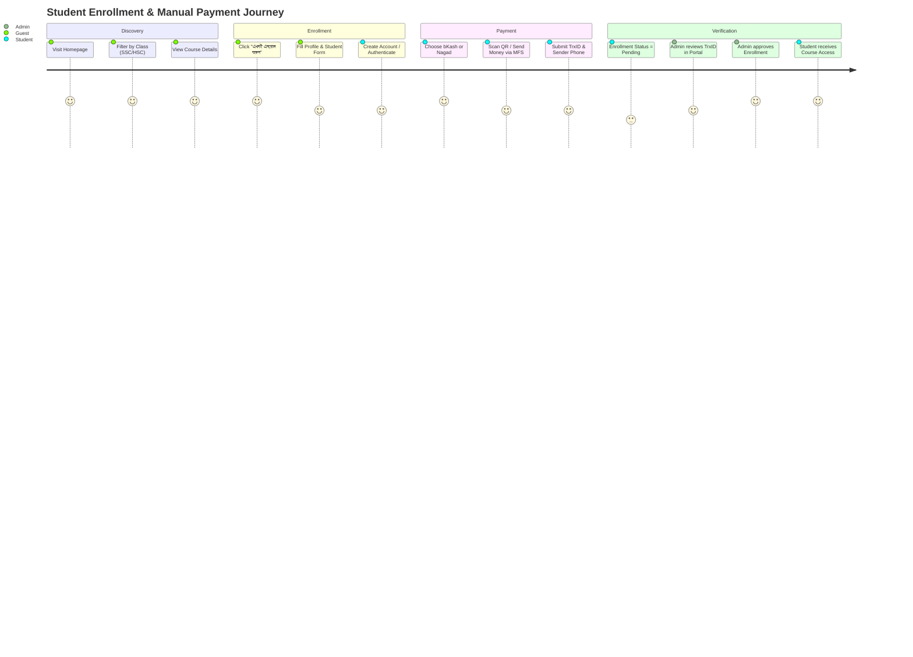
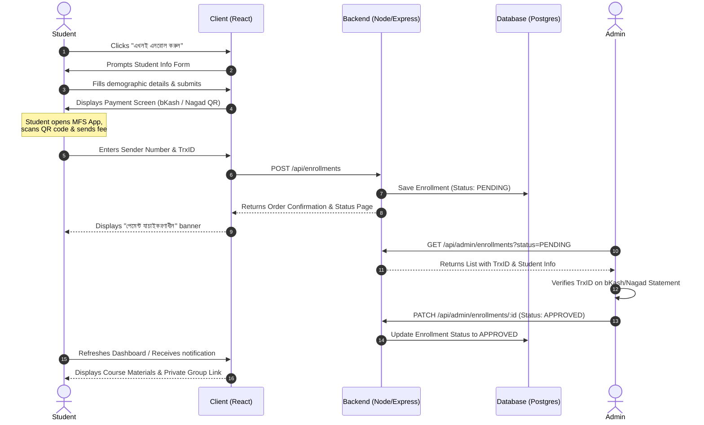
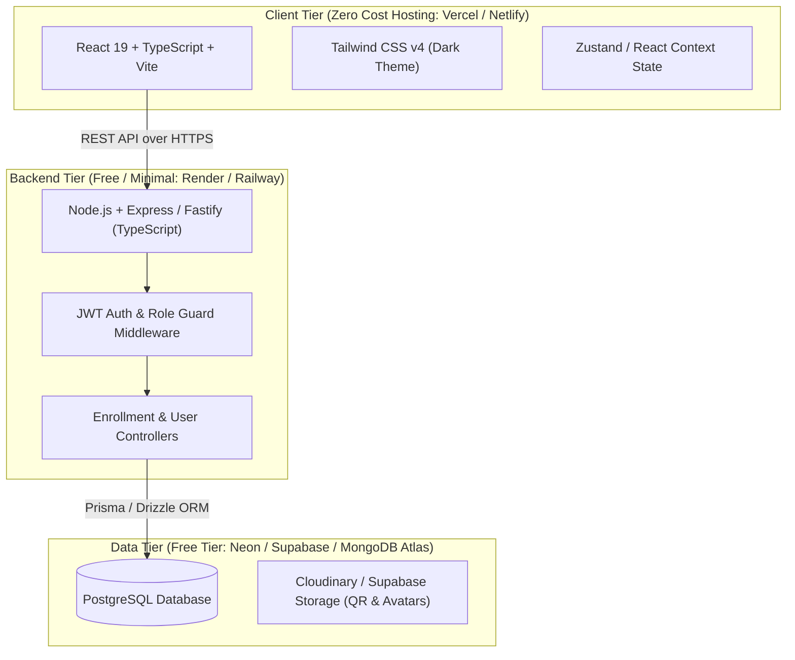
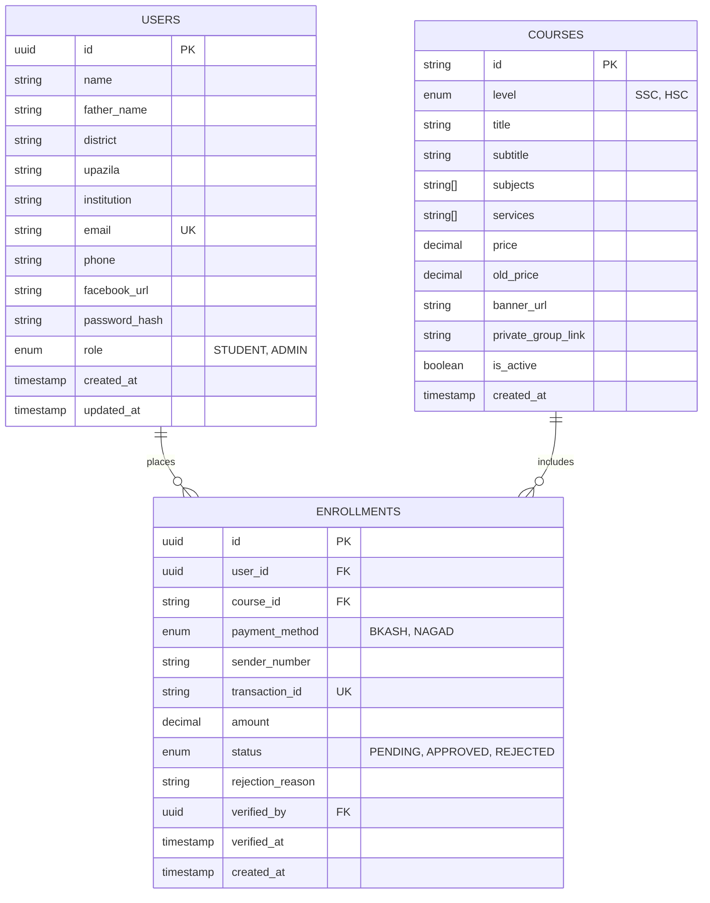
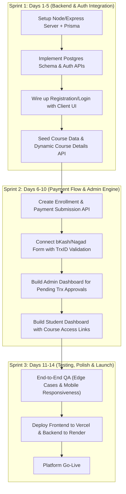

# Project Initiation Document (PID): Genius Squad EdTech Platform
**Project Code:** GS-EDTECH-MVP  
**Document Version:** 1.0.0  
**Target Delivery Window:** 7–14 Working Days  
**Budget Tier:** Low-Budget / Zero Monthly Fixed Cost Infrastructure  
**Primary Language / Localization:** Bengali (বাংলা)  
**Target Market:** Bangladeshi Secondary & Higher Secondary Students (SSC & HSC)

---

## 1. Executive Summary & Project Purpose

### 1.1 Project Overview
**Genius Squad** is an emerging Bangladeshi EdTech platform designed to provide high-quality, structured online academic coaching for secondary and higher secondary students (specifically SSC and HSC candidates). The platform allows guest students to explore course catalogs filtered by class, view detailed curriculum outlines, register with rich local student profile information, and enroll through manual mobile financial service (MFS) payments (bKash & Nagad QR codes and transaction ID submissions). An integrated administrative dashboard allows staff to manually verify transactions and approve course enrollments.

### 1.2 Core Objectives
- **Fast Time-to-Market:** Deliver a functional, secure, and production-ready MVP within 1–2 weeks utilizing the pre-built React/Tailwind frontend prototype.
- **Budget Optimization:** Keep infrastructure and maintenance costs at or near **$0/month** by leveraging free-tier modern developer platforms (Vercel, Supabase / Neon PostgreSQL, or Render).
- **Localized User Experience:** 100% Bengali interface with Bangladesh-specific form fields (Districts, Upazilas, BD phone number formatting, Facebook profile integration).
- **Reliable Manual Payment Flow:** Eliminate third-party merchant gateway charges and lengthy paperwork (e.g., SSLCOMMERZ merchant account setup) during the launch phase by employing a clean QR-code scan + TrxID verification mechanism.

---

## 2. Project Scope & Boundary

### 2.1 In-Scope (MVP Phase)
1. **Public Course Catalog & Filtering:**
   - Landing/Hero section with call-to-actions, teacher introductions, and metrics.
   - Class-based course filtering (সব কোর্স, SSC, HSC).
   - Course cards displaying pricing, discounts, subject tags, and feature bullets.
   - Comprehensive Course Details page displaying subject breakdown, included services, and floating enrollment action.
2. **Student Authentication & Profiles:**
   - Email + Password registration and authentication.
   - Standard student profile schema: Name, Father's Name, District (জেলা), Upazila (উপজেলা), School/College, Phone Number, Email, Facebook Profile Link.
   - Password hashing and secure token-based session management.
3. **Enrollment & Payment System (Manual MFS):**
   - Multi-step checkout flow (Enrollment Info confirmation → Payment method selection).
   - bKash & Nagad manual payment instructions with dynamic QR codes and personal/agent numbers.
   - Form for submitting Sender Mobile Number and Transaction ID (TrxID).
   - Order tracking page displaying real-time enrollment status (`PENDING_VERIFICATION`, `APPROVED`, `REJECTED`).
4. **Admin Verification Dashboard:**
   - Secure Admin portal with restricted access.
   - Real-time queue of pending enrollments showing student details, course name, fee, MFS method, sender number, and TrxID.
   - One-click approval / rejection action.
   - Enrolled student management and CSV export for record keeping.
5. **Post-Enrollment Access:**
   - Student dashboard showing enrolled courses and links to private learning groups (Facebook Secret Group / Telegram Group / Class Drive).

### 2.2 Out-of-Scope (Deferred to Phase 2)
- Automated payment gateway webhooks (SSLCOMMERZ, Shurjopay, bKash Merchant API).
- Native video player with DRM encryption (YouTube unlisted / Vimeo will be used via external private groups initially).
- Built-in automated live exam engine (links will be routed to Google Forms / external quiz tools initially).
- Paid SMS gateway API integration (notifications will initially be in-app and email-based).

---

## 3. User Personas & User Journeys

---

## 4. Functional Specifications

### 4.1 Module 1: Authentication & Student Profile Management
Students must register with comprehensive demographic details to facilitate identity verification and batch organization.

| Field Name | Type | Bengali Label | Required | Validation / Rules |
| :--- | :--- | :--- | :--- | :--- |
| `name` | String | শিক্ষার্থীর নাম | Yes | Minimum 3 characters |
| `father_name` | String | পিতার নাম | Yes | Minimum 3 characters |
| `district` | Dropdown | জেলা | Yes | 64 Districts of Bangladesh |
| `upazila` | String/Dropdown | উপজেলা | Yes | Valid Upazila name |
| `institution` | String | স্কুল / কলেজ | Yes | Name of School or College |
| `email` | String | ইমেইল | Yes | Valid RFC email, Unique |
| `phone` | String | ফোন নম্বর | Yes | BD Regex: `^(?:\+88|88)?(01[3-9]\d{8})$` |
| `facebook_url` | String | ফেসবুক আইডি লিংক | Yes | Valid Facebook URL or username |
| `password` | String | পাসওয়ার্ড | Yes | Minimum 6 characters (hashed with bcrypt) |

### 4.2 Module 2: Course Catalog & Details Presentation
- **Hero Section:** High-converting banner featuring platform slogan (*"প্রস্তুতি হোক জিনিয়াসদের মতো"*), dynamic statistics badge, and quick jump buttons.
- **Course Card Component:**
  - Course Image with aspect-ratio optimization.
  - Class level pill (SSC / HSC).
  - Subject tags (e.g., পদার্থবিজ্ঞান, রসায়ন, গণিত).
  - Included services badges (লাইভ MCQ, চ্যাপ্টারভিত্তিক পরীক্ষা, etc.).
  - Pricing display (Current Price + Strikethrough Regular Price).
  - Details Link (Course title and "বিস্তারিত দেখুন" button linking to `/course/:id`).
  - "এনরোল করুন" button linking directly to checkout.
- **Course Details View:**
  - Expanded syllabus breakdown and subject teachers.
  - Sticky pricing summary card with direct payment CTA.
  - Customer support hotline display (`০১৭০০-০০০০০০`).

### 4.3 Module 3: Checkout, Enrollment & Manual MFS Flow
Because official payment gateway integration involves time-consuming trade license verification and setup costs, a high-trust manual flow is implemented:

#### Payment Screen Specifications:
1. **Tabs:** bKash (বিকাশ) and Nagad (নগদ).
2. **Account Details:**
   - Account Type: Personal / Send Money (or Merchant/Make Payment).
   - Target Mobile Number with one-click copy button.
   - Static/Dynamic QR Code image for app-based scanning.
3. **Step-by-Step Bangla Instructions:**
   - ধাপ ১: বিকাশ/নগদ অ্যাপে যান এবং "Send Money" নির্বাচন করুন।
   - ধাপ ২: **০১৭০০-০০০০০০** নম্বরে নির্ধারিত ফি প্রদান করুন।
   - ধাপ ৩: লেনদেন শেষে পাওয়া Transaction ID (TrxID) এবং যে নম্বর থেকে পাঠিয়েছেন তা নিচে লিখুন।
4. **Input Fields:**
   - `sender_number`: প্রেরক নম্বর (১১ ডিজিট).
   - `trx_id`: ট্রানজেকশন আইডি (যেমন: `8N7A2BCX1`).
   - `screenshot`: (Optional) পেমেন্ট স্ক্রিনশট আপলোড.

### 4.4 Module 4: Administrative Portal (Manual Approval Engine)
A dedicated `/admin` view protected by role-based authentication (`role: 'admin'`):
- **Pending Verifications Tab:** Real-time table of pending transactions with student name, phone, course, fee, MFS method, sender number, and TrxID.
- **Action Buttons:**
  - **Approve (অনুমোদন):** Instantly grants student access to the course and records timestamp.
  - **Reject (বাতিল):** Rejects the transaction with a required note (e.g., "ভুল ট্রানজেকশন আইডি" or "টাকা জমা হয়নি").
- **Student Directory:** Searchable index of all registered students with filtering by class, district, and course.
- **Export Feature:** Export enrollment records to CSV/Excel for offline reconciliation.

---

## 5. System Architecture & Tech Stack (Low-Budget Optimization)

### 5.1 Architecture Diagram

### 5.2 Recommended Low-Budget Technology Stack

| Layer | Selected Technology | Rationale & Budget Impact |
| :--- | :--- | :--- |
| **Frontend** | React 19 + Vite + TailwindCSS 4 | Already built in `Client` directory. Blazing fast, zero bundle bloat. |
| **Frontend Hosting** | **Vercel** / **Cloudflare Pages** | **$0/month** (Free hobby tier with custom domain support and SSL). |
| **Backend API** | Node.js + Express (TypeScript) | Lightweight, matches existing JS/TS ecosystem in client, easy to maintain. |
| **Backend Hosting** | **Render.com** (Free/Starter) or **Railway** | **$0–$5/month**. High availability with automatic git-deployments. |
| **Database** | **Neon PostgreSQL** or **Supabase** | **$0/month** (Neon provides 0.5 GB storage & generous compute for free; Supabase includes 500MB DB + Auth). |
| **ORM / Query Builder** | **Prisma ORM** | Type-safe migrations, auto-generated TypeScript clients, reduces bug count. |
| **File Storage (Images/QRs)** | Cloudinary (Free) or Local Static | **$0/month** (Free tier gives 25GB managed media). |

---

## 6. Database Schema Design (PostgreSQL)

### 6.1 Data Integrity & Fraud Prevention Measures
1. **Unique Transaction IDs:** `transaction_id` carries a unique constraint in the database to prevent duplicate submissions of the same TrxID by different students.
2. **Double Verification Lock:** An enrollment cannot be approved twice; verification logs the approving admin's ID and timestamp.
3. **Regex Sanity Check:** Client and backend validate TrxID format (typically 8–10 alphanumeric characters for bKash/Nagad) before database ingestion.

---

## 7. API Endpoints Specification

### 7.1 Authentication Endpoints
- `POST /api/auth/register`: Register new student with all required profile attributes.
- `POST /api/auth/login`: Authenticate via email & password, returns JWT token + user profile.
- `GET /api/auth/me`: Get currently authenticated user profile.

### 7.2 Courses Endpoints
- `GET /api/courses`: Retrieve all active courses with class filters (`?level=SSC`).
- `GET /api/courses/:id`: Retrieve single course details, syllabus, and services.

### 7.3 Enrollment & Payment Endpoints
- `POST /api/enrollments`: Submit course enrollment with payment details (`course_id`, `payment_method`, `sender_number`, `transaction_id`).
- `GET /api/enrollments/my-enrollments`: List logged-in student's courses and approval statuses.
- `GET /api/enrollments/:id/status`: Poll or inspect single enrollment status.

### 7.4 Admin Endpoints (Protected: `role = 'ADMIN'`)
- `GET /api/admin/enrollments`: Fetch enrollment requests with filtering (`?status=PENDING`).
- `PATCH /api/admin/enrollments/:id/approve`: Approve transaction and unlock student course access.
- `PATCH /api/admin/enrollments/:id/reject`: Reject with explanatory note.
- `GET /api/admin/stats`: Summary metrics (Total Students, Pending Orders, Total Revenue).

---

## 8. Implementation Plan & Milestones (2-Week Fast Track)

### Detailed Schedule:
- **Phase 1: Backend Foundation & Authentication (Days 1–4)**
  - Initialize Express + TypeScript in `Server` folder.
  - Setup Prisma ORM connected to free cloud PostgreSQL (Neon / Supabase).
  - Implement Auth endpoints (`/register`, `/login`) and validation middleware.
  - Connect existing frontend Auth components to live backend.
- **Phase 2: Enrollment Flow & Manual Payment Integration (Days 5–8)**
  - Replace static `courses` array with backend API.
  - Wire Enrollment form to persist student demographics.
  - Integrate bKash/Nagad QR code assets and TrxID submission.
  - Implement pending confirmation screen.
- **Phase 3: Admin Review Dashboard & Course Access (Days 9–11)**
  - Build lightweight Admin dashboard page in frontend (e.g. `/admin`).
  - Implement Approve/Reject APIs with database transaction locks.
  - Add Student Dashboard (`/my-courses`) revealing private Facebook/Telegram group links upon approval.
- **Phase 4: Testing, Security & Free-Tier Deployment (Days 12–14)**
  - Security audit (CORS, Rate Limiting, input sanitization, JWT expiration).
  - Deploy Frontend to Vercel (free).
  - Deploy Backend to Render / Railway (free).
  - Production verification with test bKash/Nagad transactions.

---

## 9. Risk Assessment & Mitigations

| Risk / Challenge | Impact | Likelihood | Mitigation Strategy |
| :--- | :--- | :--- | :--- |
| **Fake or Duplicate TrxIDs** | High | High | Add unique constraint on `transaction_id`. Require sender mobile number. Train admin to cross-reference with official bKash/Nagad Merchant statement before approval. |
| **Verification Delay Backlog** | Medium | Medium | Display clear disclaimer: *"আপনার পেমেন্টটি সর্বোচ্চ ২ ঘণ্টার মধ্যে যাচাই করা হবে"*. Admin notifications via Telegram bot or Email alert on new submissions. |
| **Free Tier Server Inactivity Sleep (Render)** | Low | High | Use a lightweight ping cron or host on Railway/Cloudflare Workers, or notify users during cold starts. |
| **High Drop-off at Enrollment** | High | Medium | Keep registration and enrollment as seamless as possible; prefill profile fields if user is already logged in. |

---

## 10. Cost Breakdown & Budget Projections

| Resource / Tool | Selected Vendor | Estimated Monthly Cost | Notes |
| :--- | :--- | :--- | :--- |
| **Frontend Web Hosting** | Vercel Hobby Tier | **$0.00** | Unlimited static bandwidth, SSL certificate included. |
| **Backend Web Server** | Render.com Free / Railway | **$0.00 – $5.00** | Standard Node runtime. |
| **Database** | Neon.tech / Supabase Free | **$0.00** | 500MB – 1GB database, sufficient for > 15,000 active students. |
| **Media & QR Storage** | Cloudinary Free Tier | **$0.00** | 25GB bandwidth & storage. |
| **Domain Name** | Namecheap / ExonHost | **$10.00 – $12.00 / year** | Annual one-time domain cost (`geniussquad.com` or `.com.bd`). |
| **Total Estimated Operating Cost** | — | **$0 to $5 / month** | **Optimal for zero/low-budget bootstrap phase.** |

---

## 11. Approval & Sign-Off

| Stakeholder Role | Responsibilities | Status |
| :--- | :--- | :--- |
| **Product Owner (Client)** | Requirement confirmation, bKash/Nagad number setup, final acceptance | Pending Review |
| **Lead Developer** | Architecture design, full-stack implementation, deployment | Ready to Execute |
