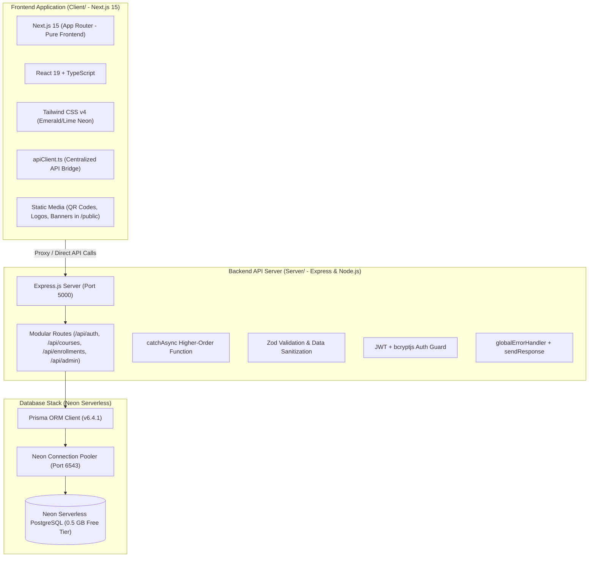
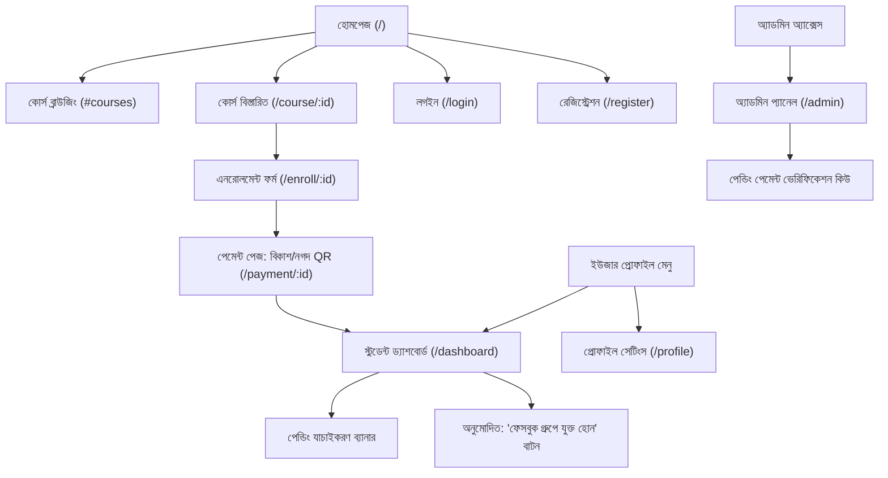
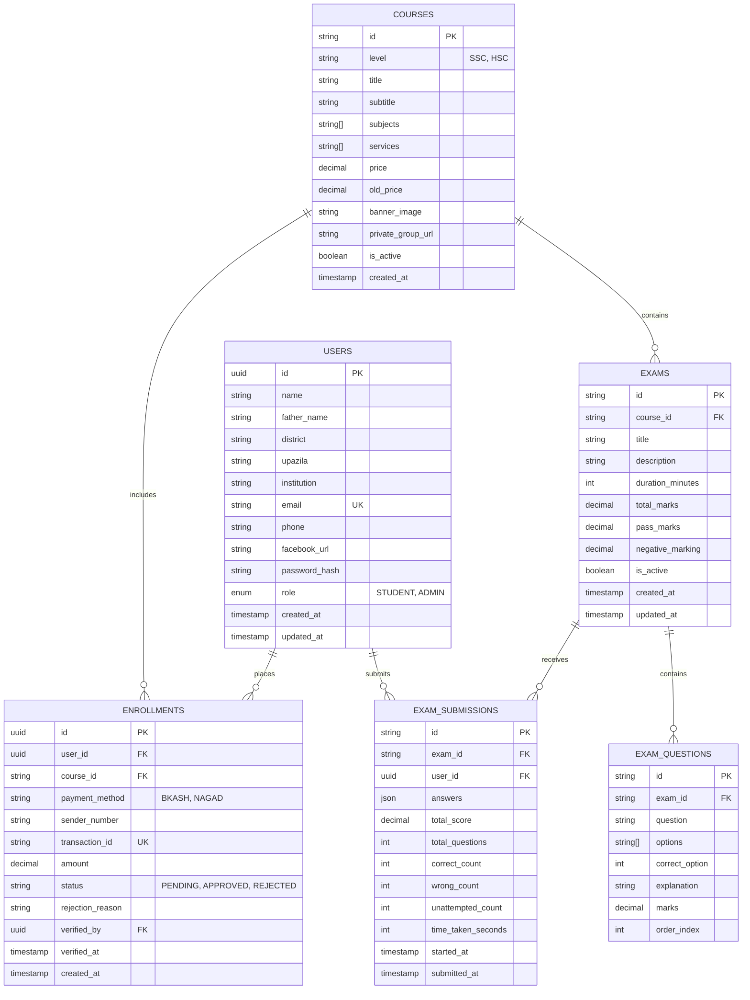
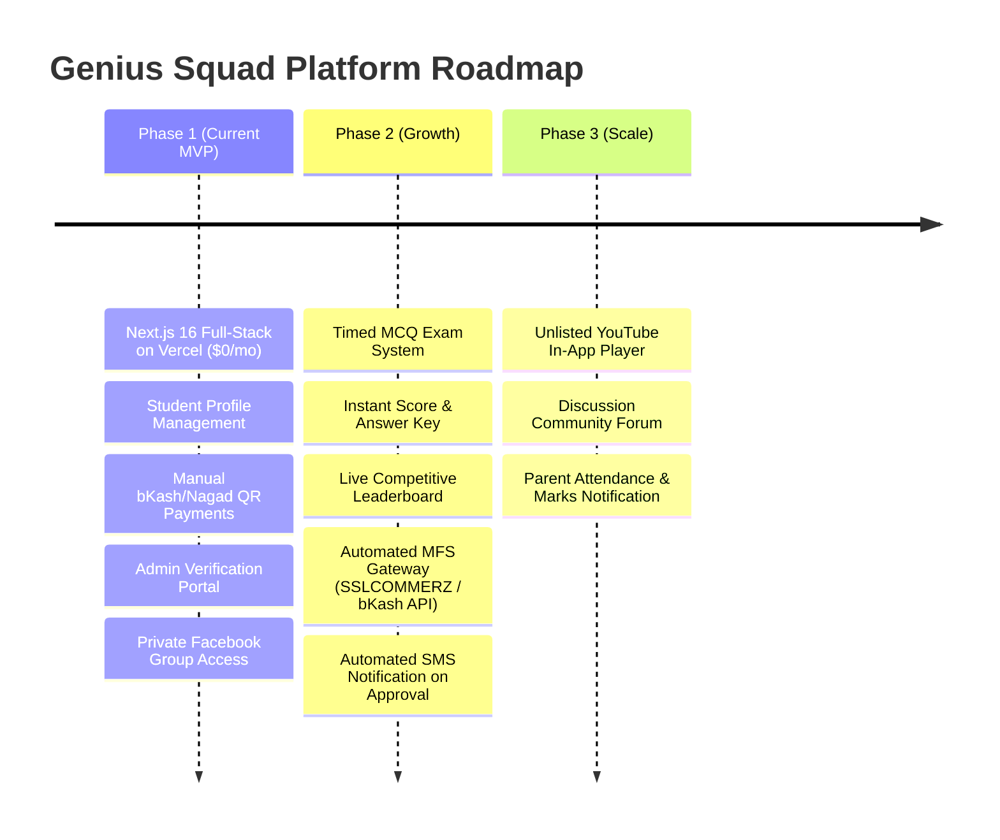

# Product Requirements Document (PRD): Genius Squad EdTech Platform

**Product Name:** Genius Squad (জিনিয়াস স্কোয়াড)  
**Document Version:** 1.5.0  
**Status:** Approved for Implementation  
**Target Release:** MVP (Phase 1)  
**Architecture Tier:** Decoupled Architecture — Next.js 15 (Frontend in `Client/`) + Standalone Express API (Backend in `Server/`) + Neon PostgreSQL  
**Primary Language / Localization:** Bengali (বাংলা)  
**Target Market:** Bangladeshi Secondary (SSC) & Higher Secondary (HSC) Students  

---

## 1. Product Vision & Operational Strategy

### 1.1 Product Vision
**Genius Squad** is a streamlined Bangladeshi EdTech web platform designed to provide high-quality, structured online academic coaching for secondary (SSC) and higher secondary (HSC) students.

### 1.2 Core MVP Strategy: Lean & Zero-Cost Operations
To launch quickly under strict low-budget and time-critical constraints:
- **Direct Private Group Fulfillment:** Instead of building an expensive video streaming player, students are directly provided with a verified link to the course's **Private Facebook Group** upon payment approval.
- **Manual MFS Verification (bKash & Nagad):** Avoids costly gateway licensing fees. Payments are made via QR code scanning and manual TrxID submission, reviewed directly by platform administrators.
- **Decoupled Client & Server Architecture ($0/month):**
  - **Frontend (`Client/`):** Next.js 15 App Router running strictly as the user interface, with Turbopack and Tailwind CSS v4.
  - **Backend (`Server/`):** Dedicated Node.js + Express + TypeScript API server in `Server/` with modular routing, Zod validation, JWT authentication, and Prisma ORM.
  - **Database:** Serverless Neon PostgreSQL (with connection pooling via PgBouncer on port 6543).

---

## 2. Technology Stack & Infrastructure Specifications

As finalized during architectural review, the frontend technology is standardized on **Next.js 15 (App Router)** for frontend delivery, and the backend is encapsulated inside **`Server/`** as an Express application.



### 2.1 Complete Technology Matrix

| Layer | Selected Technology | Role & Purpose | Budget / Cost Impact |
| :--- | :--- | :--- | :--- |
| **Frontend Framework** | **Next.js 15 (App Router in `Client/`)** | Dedicated frontend UI framework with Server Components, optimized font/image loaders, and automatic route splitting. | **$0.00** (Open Source) |
| **UI Library** | **React 19** | Modern reactive component rendering with Client Components (`'use client'`). | **$0.00** (Open Source) |
| **Styling & CSS** | **Tailwind CSS v4** | Modern utility-first styling with dark green/neon edtech palette (`#07110e`, `#b7f34a`). | **$0.00** (Open Source) |
| **Backend Framework** | **Express.js (`Server/`)** | Standalone Node.js Express server running on port 5000 with clean modular architecture. | **$0.00** (Open Source) |
| **Validation & Sanitization** | **Zod** | Schema-based strict payload validation and sanitization for all API routes. | **$0.00** (Open Source) |
| **Password Hashing** | **bcryptjs** | Salted, cryptographic password hashing (work factor 10). | **$0.00** (Open Source) |
| **Session & Auth Tokens** | **jsonwebtoken (JWT)** | Stateless, signed bearer tokens for student and admin sessions. | **$0.00** (Open Source) |
| **Database** | **Neon.tech PostgreSQL** | Fully managed serverless PostgreSQL database with 0.5 GB free storage. | **$0.00** (Free Tier, no credit card required) |
| **Connection Pooler** | **Neon PgBouncer (Port 6543)** | Queues and pools hundreds of concurrent database connections safely. | **$0.00** (Included with Neon) |
| **ORM / Query Builder** | **Prisma ORM (v6.4.1)** | Type-safe migrations, auto-generated TypeScript queries, SQL injection defense. | **$0.00** (Open Source) |
| **Hosting Platform** | **Vercel (Client) + Render/Railway/Vercel (Server)** | Client on Vercel Hobby Tier; Backend on free Node.js hosting or Vercel serverless. | **$0.00** (Hobby Tier) |
| **Media & QR Storage** | **`Client/public/`** | Static assets bundled into frontend (bKash/Nagad QRs, teacher photos). | **$0.00** (Included) |
| **Total Monthly Operating Cost** | — | — | **$0.00 / month (Permanently Free)** |

---

### 2.2 Client Handover & Private Repository Deployment
- **Private Repository Support:** Vercel Hobby Tier natively supports **private GitHub repositories** for Next.js at zero cost.
- **Handover Workflow:**
  1. Transfer the private GitHub repository to the client's GitHub account.
  2. The client signs up for a free Vercel account (Hobby Tier — $0).
  3. Use Vercel's **"Transfer Project"** feature in Project Settings to move the Next.js project to the client's account in 2 clicks.
  4. Client has 100% ownership with **$0/month** recurring fees.

---

## 3. User Roles, Role Governance & Downgrade Policy

### 3.1 Role Hierarchy Matrix

| Role | Description | Core Capabilities & Boundaries |
| :--- | :--- | :--- |
| **Guest Student** | Unauthenticated visitor | Browse homepage, filter courses by class (SSC/HSC), view course details, initiate enrollment/registration. |
| **Registered Student (`STUDENT`)** | Authenticated learner | Default role for all registrations. Enroll in courses, submit MFS payment details (TrxID), track enrollment status on **Student Dashboard (`/dashboard`)**, access **Private Facebook Group** upon approval, and edit profile settings. |
| **Platform Administrator (`ADMIN`)** | Operational reviewer | Access **Admin Panel (`/admin`)**, verify/reject MFS transactions, manage courses (`/admin/courses`), view user list (`/admin/users`), promote students to admin (`ADMIN`), and suspend/unsuspend student accounts. Strictly barred from student dashboard (`/dashboard`). Cannot downgrade, suspend, or delete other admins. |
| **Super Administrator (`SUPER_ADMIN`)** | Root platform owner | Unique single account (`admin@geniussquad.com`). Holds all Admin privileges plus sole governance authority: can downgrade any Admin back to Student (`STUDENT`), suspend admin accounts, or delete admins. Root account cannot be modified, downgraded, suspended, or deleted by anyone. |

### 3.2 Role Governance & Downgrade Policy

1. **Default Registration:** All new user accounts registered through the web portal are strictly assigned the `STUDENT` role.
2. **Admin Promotion Authority:** Any existing `ADMIN` (or `SUPER_ADMIN`) can promote an active `STUDENT` to the `ADMIN` role.
3. **Exclusive Super Admin Downgrade Authority:**
   - Once a user is an `ADMIN`, standard administrators cannot modify their role, suspend them, or delete them (rendered as `Protected` in UI and enforced with `403 Forbidden` on backend API routes).
   - **Only the `SUPER_ADMIN` has the authority to downgrade an Admin's role back to `STUDENT`** via `PATCH /api/v1/admin/users/:id/role`.
   - Only the `SUPER_ADMIN` can suspend or delete an `ADMIN` account.
4. **Single Root Super Admin Guarantee:** The `SUPER_ADMIN` role is unique and held by only one root account. The system prevents creating multiple Super Admins or altering the Super Admin's role.
5. **Account Suspension & Safe Deletion:**
   - Administrators can suspend a student's access (`isSuspended: true`) without deleting their educational or financial records.
   - Deleting a user with existing course enrollments or payments will automatically convert the action into an account suspension to preserve financial audit logs.

---

## 4. Information Architecture & Sitemap



---

## 5. Security Architecture & Implementation Cautions

> [!CAUTION]
> ### Mandatory Security Rules for Implementing Agents & Developers
> 1. **Zero-Trust Identity Extraction (IDOR Prevention):**
>    - The backend/Route Handlers must **NEVER** accept or trust a `userId` supplied in the request body, URL parameters, or query strings for profile updates or personal orders.
>    - `userId` must **always** be extracted directly from the verified JWT payload (`req.user.id`).
> 2. **Role-Based Server-Side Guards (No Client-Only Security):**
>    - Frontend route protection is only a visual UX convenience. Every admin endpoint (`/api/admin/*`) **must** be protected on the server by the `auth('ADMIN')` middleware.
> 3. **Payment Tampering & Server-Side Pricing Authority:**
>    - The frontend must **never** send the payment `amount` to the database. The backend must query the official course fee from the database using `course_id` and assign that amount to the enrollment record.
> 4. **TrxID Deduplication & Fraud Defense:**
>    - The database must enforce a strict `UNIQUE` constraint on `transaction_id`.
>    - All TrxIDs must be validated against a strict alphanumeric regex (`^[A-Za-z0-9]{8,12}$`).
>    - Course access must **never** be granted automatically upon TrxID submission; it must remain `PENDING` until an admin manually cross-checks their MFS statement.
> 5. **Password & Credential Hashing:**
>    - Passwords must be hashed using `bcryptjs` (work factor $\ge 10$). Never log, return, or store plaintext passwords.
> 6. **Rate Limiting:**
>    - Apply rate limiting to sensitive routes (`/api/auth/login`, `/api/auth/register`, `/api/enrollments`) to prevent brute-force credential stuffing and bot spam.
> 7. **No Unnecessary Console Logs in Production (Information Leakage Prevention):**
>    - Never use or leave unnecessary `console.log`, `console.info`, `console.debug`, or `console.dir` statements in production code (both frontend and backend).
>    - Exposing runtime state, user demographic records, authentication tokens (JWTs), or internal system structures causes critical data leakage vulnerabilities and increases memory consumption.
>    - All unexpected errors must be handled gracefully in the UI or via structured, sanitized server error handlers.

---

## 6. Architectural Standards: DRY & Reusable Next.js Patterns

The implementing agent **must** adhere strictly to the DRY principle across the entire backend and frontend.

### 6.1 Backend / API Route Handlers DRY Utilities

```
app/
├── (auth)/
│   ├── login/page.tsx
│   └── register/page.tsx
├── (dashboard)/
│   ├── dashboard/page.tsx
│   └── profile/page.tsx
├── admin/page.tsx
├── course/[id]/page.tsx
├── enroll/[id]/page.tsx
├── payment/[id]/page.tsx
├── api/
│   ├── auth/route.ts
│   ├── users/profile/route.ts
│   ├── courses/route.ts
│   ├── enrollments/route.ts
│   └── admin/enrollments/route.ts
├── layout.tsx
└── page.tsx
```

#### 1. Standardized API Response Helper: `sendResponse`
All Route Handlers follow a uniform, predictable envelope:

```typescript
// lib/sendResponse.ts
import { NextResponse } from 'next/server';

interface ResponsePayload<T> {
  statusCode: number;
  success: boolean;
  message?: string;
  data?: T;
  meta?: Record<string, unknown>;
}

export const sendResponse = <T>(payload: ResponsePayload<T>) => {
  return NextResponse.json(
    {
      success: payload.success,
      message: payload.message || null,
      data: payload.data || null,
      meta: payload.meta || null,
    },
    { status: payload.statusCode }
  );
};
```

#### 2. Generic Authentication & Role Guard Helper
```typescript
// lib/auth.ts
import { NextRequest } from 'next/server';
import jwt from 'jsonwebtoken';
import { AppError } from './AppError';

export interface TokenPayload {
  id: string;
  role: 'STUDENT' | 'ADMIN';
}

export const verifyAuth = (req: NextRequest, ...requiredRoles: ('STUDENT' | 'ADMIN')[]): TokenPayload => {
  const authHeader = req.headers.get('authorization');
  if (!authHeader?.startsWith('Bearer ')) {
    throw new AppError(401, 'অননুমোদিত অ্যাক্সেস। অনুগ্রহ করে লগইন করুন।');
  }

  const token = authHeader.split(' ')[1];
  const decoded = jwt.verify(token, process.env.JWT_SECRET!) as TokenPayload;

  if (requiredRoles.length && !requiredRoles.includes(decoded.role)) {
    throw new AppError(403, 'এই তথ্যে অ্যাক্সেস করার অনুমতি আপনার নেই।');
  }

  return decoded;
};
```

---

### 6.2 Zod Validation Schemas

```typescript
// lib/schemas/authSchemas.ts
import { z } from 'zod';

export const registerSchema = z.object({
  name: z.string().min(3, 'শিক্ষার্থীর নাম কমপক্ষে ৩ অক্ষর হতে হবে'),
  father_name: z.string().min(3, 'পিতার নাম কমপক্ষে ৩ অক্ষর হতে হবে'),
  district: z.string().min(2, 'সঠিক জেলা নির্বাচন করুন'),
  upazila: z.string().min(2, 'উপজেলা লিখুন'),
  institution: z.string().min(2, 'স্কুল বা কলেজের নাম লিখুন'),
  email: z.string().email('সঠিক ইমেইল ঠিকানা দিন'),
  phone: z.string().regex(/^(?:\+8801|01)[3-9]\d{8}$/, 'সঠিক ১১ ডিজিটের ফোন নম্বর দিন (যেমন: 017XXXXXXXX)'),
  facebook_url: z.string().min(3, 'সঠিক ফেসবুক প্রোফাইল লিংক দিন'),
  password: z.string().min(6, 'পাসওয়ার্ড কমপক্ষে ৬ অক্ষরের হতে হবে'),
});

export const loginSchema = z.object({
  email: z.string().email('সঠিক ইমেইল ঠিকানা দিন'),
  password: z.string().min(1, 'পাসওয়ার্ড প্রদান করুন'),
});

export const updateProfileSchema = z.object({
  name: z.string().min(3).optional(),
  father_name: z.string().min(3).optional(),
  district: z.string().min(2).optional(),
  upazila: z.string().min(2).optional(),
  institution: z.string().min(2).optional(),
  facebook_url: z.string().min(3).optional(),
  phone: z.string().regex(/^(?:\+8801|01)[3-9]\d{8}$/).optional(),
  current_password: z.string().optional(),
  new_password: z.string().min(6).optional(),
});

export const createEnrollmentSchema = z.object({
  course_id: z.string().min(1, 'কোর্স আইডি আবশ্যক'),
  payment_method: z.enum(['bKash', 'Nagad'], { message: 'পেমেন্ট মাধ্যম বিকাশ অথবা নগদ হতে হবে' }),
  sender_number: z.string().regex(/^(?:\+8801|01)[3-9]\d{8}$/, 'সঠিক প্রেরক নম্বর দিন'),
  transaction_id: z.string().regex(/^[A-Za-z0-9]{8,12}$/, 'সঠিক ট্রানজেকশন আইডি দিন (৮–১২ অক্ষর)'),
});
```

---

## 7. Database Schema Design (PostgreSQL / Prisma)



---

## 8. Phased Roadmap



---

## 9. MCQ Exam & Live Leaderboard System Specification

### 9.1 System Overview & Learning Objectives
The **Genius Squad Exam System** delivers structured, competitive Multiple Choice Question (MCQ) assessments tailored for Bangladeshi SSC and HSC learners. Designed to mirror realistic board-exam and university-admission test conditions, the engine provides synchronized timed exams, instant automated grading with negative marking, step-by-step solution sheets, and dynamic live leaderboards.

### 9.2 Administrative Capabilities (Exam Creation & Answer Sheet)
1. **Exam Configuration (`/admin/exams`):**
   - **Exam Metadata:** Title (e.g., *"SSC ২০২৫ পদার্থবিজ্ঞান: গতিবিদ্যা ও বল ফাইনাল মডেল টেস্ট"*), associated Course, and syllabus description.
   - **Time Management:** Allotted duration in minutes (e.g., 15, 25, 45, or 60 minutes).
   - **Grading & Negative Marking Rules:**
     - Marks per correct question (default: 1.0).
     - Negative marking penalty per incorrect question (e.g., 0.0, 0.25, or 0.50 marks).
     - Passing marks threshold.
   - **Lifecycle Control:** Draft vs. Published (`isActive`).
2. **Question Builder & Official Answer Sheet:**
   - Admins can add an unlimited number of MCQ questions per exam.
   - Each question comprises:
     - Question statement (supporting Bengali text and LaTeX/math formulas).
     - 4 or 5 options.
     - **Mandatory Answer Sheet:** Exact index (0-3) of the correct answer.
     - **Detailed Solution / Explanation:** Pedagogical explanation displayed in the post-exam answer review.
   - Question re-ordering and live question preview before publishing.

### 9.3 Student Assessment Experience
1. **Pre-Exam Briefing:**
   - Displays exam rules, question count, duration, scoring scheme (+1 / -0.25), and instructions before the countdown begins.
2. **Live Timed Exam Interface (`/exams/[id]/take`):**
   - **Anti-Cheat Payload Protection:** The server strips all `correctOption` and `explanation` fields when serving questions to students during an active exam. Answers are calculated strictly on the backend after submission.
   - **Synchronized Countdown Timer:** Prominent sticky timer showing remaining time.
   - **Automatic Submission:** If the countdown reaches `00:00`, the exam automatically bundles selected responses and submits them immediately.
   - **Interactive Question Palette:** Quick-jump question navigation, visual indicators for answered vs. unattempted questions, and a "Mark for Review" flag.
3. **Instant Evaluation & Results (`/exams/[id]/result`):**
   - **Instant Scorecard:**
     - Total score (accounting for negative marking).
     - Total correct, wrong, and unattempted counts.
     - Accuracy percentage and total time spent.
   - **Full Answer Sheet Review (উত্তরমালা ও সমাধান):**
     - Side-by-side comparison of the student's selected answer vs. the official correct answer.
     - Color-coded badges (Green for correct, Red for wrong, Slate for skipped).
     - Teacher's solution/explanation card for every question.
4. **Live Exam Leaderboard (মেধাতালিকা):**
   - Dynamically calculated ranking of all students who completed the exam.
   - **Deterministic Tie-Breaking Algorithm:**
     1. Primary: Highest `totalScore` DESC.
     2. Secondary: Lowest `timeTakenSeconds` ASC (faster completion ranks higher).
     3. Tertiary: Earlier `submittedAt` timestamp ASC.
   - Displays rank badges (🥇 ১ম, 🥈 ২য়, 🥉 ৩য়, ৪–১০ম...), Student Name, Institution, District, Marks, and Time Taken.
