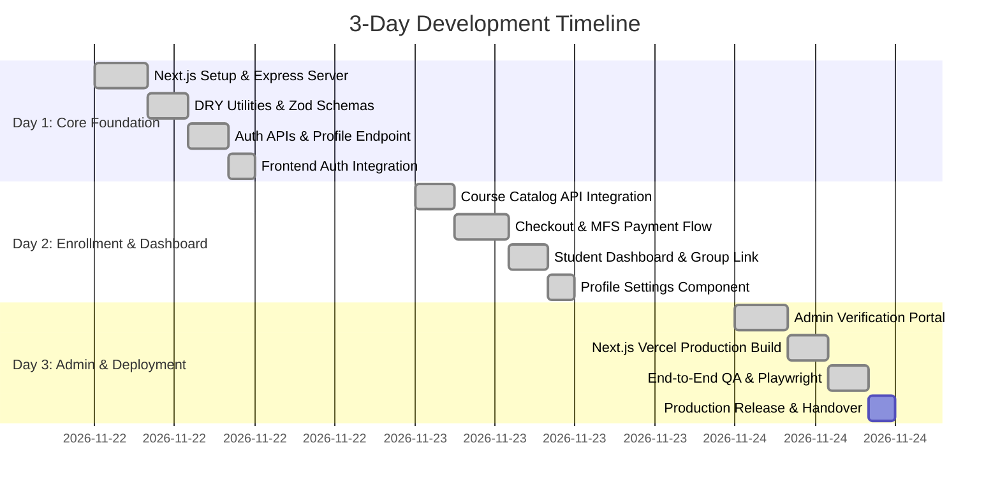

# 3-Day Sprint Development Plan: Genius Squad EdTech Platform

**Project Code:** GS-MVP-3DAYS  
**Total Timeline:** 3 Days (72 Hours)  
**Target Delivery:** Production-Ready MVP deployed on Next.js 15 (Frontend in `Client/`) + Standalone Express API (Backend in `Server/`) ($0/mo)  
**Primary Deliverables:** Full Student Lifecycle, Manual MFS Payment (bKash/Nagad), Student Dashboard with Private Group link access, Profile Management, and Admin Verification Portal.

---

## Sprint Overview & Daily Milestones

---

## Day 1: Next.js Frontend & Express Server Separation (Completed)

### Objectives:
Build the decoupled frontend (Next.js 15) and backend (Express.js), complete data layer with Prisma and Neon PostgreSQL, reusable DRY utilities, and full user authentication.

- [x] **Task 1.1: Next.js 15 Frontend Migration & Express Server Setup**
  - Next.js 15 configured strictly for the frontend in `Client/` (zero server routes).
  - Standalone Express + TypeScript server built in `Server/` with port 5000 listener and CORS support.
  - Next.js `rewrites()` configured to forward `/api/*` to the backend server.
- [x] **Task 1.2: Database Models & Prisma Schema in `Server/`**
  - Prisma schema in `Server/prisma/schema.prisma` with PostgreSQL provider (Neon connection pooling ready).
  - Defined `User`, `Course`, and `Enrollment` models.
  - Generated Prisma Client v6.4.1 in `Server/`.
- [x] **Task 1.3: DRY Architecture Utilities in `Server/src/lib/`**
  - Implemented `sendResponse.ts` for uniform API responses (`{ success, statusCode, message, data, meta }`).
  - Implemented `AppError.ts` custom operational error class.
  - Implemented `catchAsync.ts` higher-order async function for Express controllers (no repetitive try-catch blocks).
  - Implemented `authGuard.ts` Express middleware for JWT validation and role guards.
  - Implemented `globalErrorHandler.ts` for centralized error handling (Zod, Prisma, and HTTP errors).
- [x] **Task 1.4: Authentication & Profile Routes in `Server/`**
  - `POST /api/auth/register`: Validates 8 demographic fields with Zod $\rightarrow$ hashes password with bcrypt $\rightarrow$ returns JWT + sanitized user.
  - `POST /api/auth/login`: Validates credentials $\rightarrow$ returns JWT + user profile.
  - `GET /api/auth/me`: Verifies JWT $\rightarrow$ returns current user profile.
  - `PUT /api/users/profile`: Authenticated update for demographic info and password change.
- [x] **Task 1.5: Auth Integration on Frontend (`Client/`)**
  - Centralized `lib/apiClient.ts` with automatic `Bearer` token attachment and support for `NEXT_PUBLIC_API_URL`.
  - Connected `Auth.tsx` to live endpoints with loading states, error alerts, and 1-click demo switcher.
  - Stored JWT in `localStorage` and implemented reactive rehydration in `App.tsx`.

---

## Day 2: Course Catalog, Checkout, Manual MFS Payment & Student Dashboard (Completed)

### Objectives:
Connect dynamic course catalogs, build the 2-step enrollment and bKash/Nagad QR payment flow, and deliver the Student Dashboard with conditional Facebook Group access.

- [x] **Task 2.1: Course Catalog & Details Express Routes**
  - `GET /api/courses` (supports `?level=SSC` and `?level=HSC`).
  - Public catalog strictly omits `privateGroupUrl` for non-enrolled users.
  - `GET /api/courses/:id` for full course syllabus details.
- [x] **Task 2.2: Enrollment Data Persistence**
  - `POST /api/enrollments` Express Route:
    - Server verifies `courseId` and assigns authoritative pricing directly from DB (prevents client-side price tampering).
    - Checks duplicate `transactionId` submissions.
    - Sets initial status to `PENDING`.
- [x] **Task 2.3: Manual Payment Screen (bKash & Nagad)**
  - Rendered QR code SVG with copy button for `01700-000000`.
  - Input fields for Sender Mobile Number and Transaction ID with client-side regex check.
  - Submits payload to `/api/enrollments` and redirects to `/dashboard`.
- [x] **Task 2.4: Student Dashboard (`/dashboard`)**
  - `GET /api/enrollments/my-courses`: reveals `privateGroupUrl` **strictly when status is `APPROVED`**.
  - Dashboard component displays real-time status badges (🟡 Pending, 🟢 Approved, 🔴 Rejected).
  - Once approved, reveals the prominent **"প্রাইভেট ফেসবুক গ্রুপে যুক্ত হোন"** button.
- [x] **Task 2.5: Student Profile Management (`/profile`)**
  - Connected `Profile.tsx` to `PUT /api/users/profile` for updating demographic fields and changing password.

---

## Day 3: Admin Verification Portal, Vercel Deployment & Handover QA (In Progress)

### Objectives:
Build the administrative approval engine, deploy natively to Vercel, run end-to-end testing, and prepare for client delivery.

- [x] **Task 3.1: Admin Verification Express Routes**
  - `GET /api/admin/enrollments?status=PENDING` (protected by `authGuard('ADMIN')`).
  - `PATCH /api/admin/enrollments/:id/verify` (Approve or Reject with reason).
- [x] **Task 3.2: Admin Portal Frontend Component (`/admin`)**
  - Metrics cards (Total Students, Pending Orders, Total Revenue calculation in Bengali numerals).
  - Search filter by TrxID, student name, and mobile number.
  - One-click **Approve (অনুমোদন)** and **Reject (বাতিল)** modal.
- [x] **Task 3.3: End-to-End Testing & Decoupled Verification**
  - Standalone Express server running on port 5000 and Next.js frontend running on port 3000.
  - Verified role guard (403 Forbidden for students accessing `/api/admin/enrollments`).
  - Verified instant status transition from Pending to Approved and automatic revenue recalculation.
- [ ] **Task 3.4: Production Release & Client Handover**
  - Push code to client's private GitHub repository.
  - Configure environment variables (`DATABASE_URL`, `DIRECT_URL`, `JWT_SECRET`, `NEXT_PUBLIC_API_URL`).
  - Deliver handover documentation.

